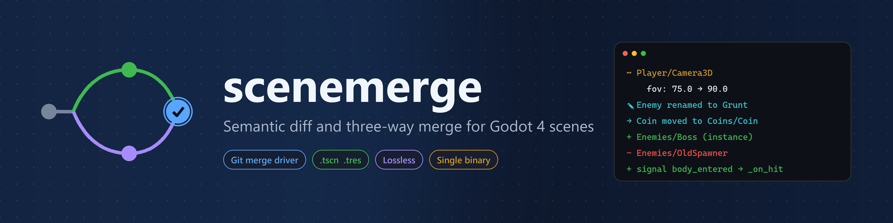
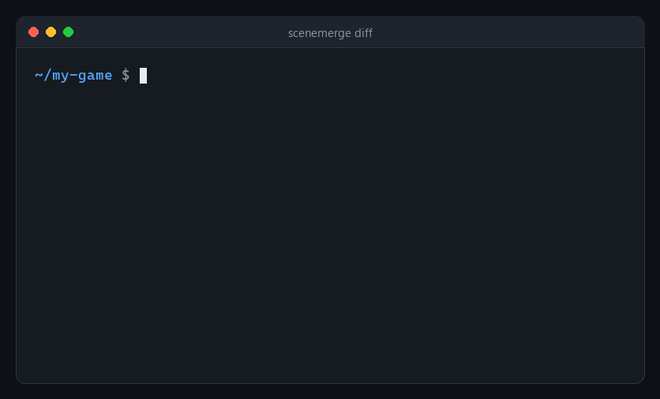
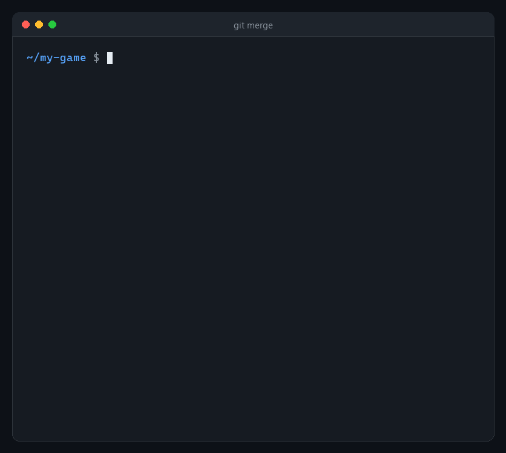
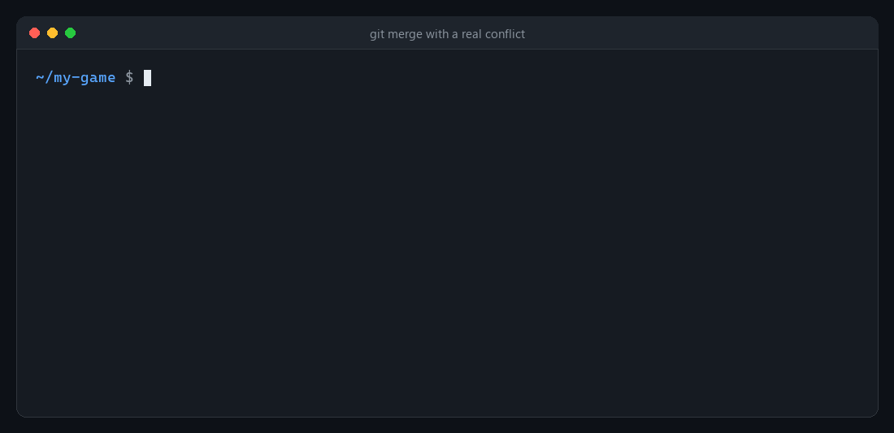

<p align="center">
  
</p>

<p align="center">
  <a href="https://github.com/safdafang/scenemerge/actions/workflows/ci.yml"></a>
  <a href="https://github.com/safdafang/scenemerge/actions/workflows/godot-integration.yml"></a>
  <a href="https://github.com/safdafang/scenemerge/releases"></a>
  
  
  <a href="LICENSE"></a>
</p>

<p align="center">
  <b>Git understands lines. scenemerge understands scenes.</b><br>
  A single binary that plugs into Git as diff and merge driver for <code>.tscn</code> and <code>.tres</code> files,<br>
  and works just as well in a terminal or in CI.
</p>

<p align="center">
  <a href="#installation">Installation</a> ·
  <a href="#set-up-git-in-one-command">Git setup</a> ·
  <a href="#commands">Commands</a> ·
  <a href="#how-it-works">How it works</a> ·
  <a href="README.ru.md">Русский</a>
</p>

## Why

Godot scenes are text files, but Git compares them line by line. Whenever the
editor saves a scene it may renumber resource ids (`ExtResource("1_abcde")`
turns into `ExtResource("3_xyz12")`), reorder sections and add identifiers. A one
line change becomes a wall of diff, and two people who touched *different*
nodes of the same scene get a merge conflict anyway.

Godot cannot open a scene that contains `<<<<<<<` conflict markers, so teams
usually resolve such conflicts by taking one side of the file and throwing the
other side's work away. **scenemerge** reads the structure of the scene (nodes,
properties, resources, signal connections) and merges that structure. Changes
to different nodes or properties merge automatically, id renumbering is
invisible, and a real conflict is reduced to the single property line that
actually conflicts.

## See it in action

### A diff that shows what changed in the scene

<p align="center"></p>

Renumbered ids, reordered `[ext_resource]` sections, `load_steps` and the
`unique_id`s added by Godot 4.6 are not changes and are not shown.

### Plain Git conflicts, scenemerge merges

<p align="center"></p>

Both branches edited `level.tscn`: one renumbered the resources and changed the
camera, the other added a HUD texture and moved an enemy. A line based merge
fails, the semantic merge succeeds and keeps everything.

### Real conflicts are one line, not half the file

<p align="center"></p>

Everything else in the file is already merged. Fix the marked line, open the
scene in Godot, commit.

## Installation

**Prebuilt binaries** for Linux (static), macOS (Intel and Apple Silicon) and
Windows are attached to every [release](https://github.com/safdafang/scenemerge/releases).
Put `scenemerge` (or `scenemerge.exe`) somewhere on your `PATH`.

**With Cargo** (Rust 1.88 or newer):

```sh
cargo install --git https://github.com/safdafang/scenemerge scenemerge
```

## Set up Git in one command

Run this inside the repository of your Godot project:

```sh
scenemerge install
```

It adds two lines to `.gitattributes`

```gitattributes
*.tscn diff=godot-scene merge=godot-scene
*.tres diff=godot-scene merge=godot-scene
```

and registers the drivers in `.git/config`:

```ini
[diff "godot-scene"]
    textconv = scenemerge textconv
[merge "godot-scene"]
    name = Godot semantic scene merge
    driver = scenemerge merge %O %A %B -o %A --path %P --marker-size %L --on-error text --label-base %S --label-ours %X --label-theirs %Y
```

Commit `.gitattributes` so the whole team uses it. Every team member runs
`scenemerge install` once, because Git configuration is not versioned.

| option | effect |
|---|---|
| `install --global` | configure all your repositories (global Git config and global attributes file) |
| `install --diff semantic` | `git diff` prints the semantic change tree instead of a cleaned up line diff |
| `uninstall [--global]` | remove exactly what `install` added |

Running `install` again changes nothing. If a file cannot be merged
semantically (for example a Godot 3 file), the driver falls back to the normal
line based merge of Git. After setup, `git diff`, `git log -p`, `git merge`,
`git rebase`, `git cherry-pick` and `git pull` all use scenemerge for scenes.

## Commands

| command | what it does |
|---|---|
| `scenemerge diff OLD NEW` | semantic diff; `--format human` (default), `json` or `text` |
| `scenemerge merge BASE OURS THEIRS -o OUT` | three-way merge; exit code 0 clean, 1 conflicts, 2 error |
| `scenemerge textconv FILE` | canonical text form, which is what `git diff` compares |
| `scenemerge check FILE_OR_DIR...` | parse, validate and verify the lossless round trip; handy in CI |
| `scenemerge install` / `uninstall` | set up or remove the Git integration |

Useful options:

* `diff --ignore-editor-metadata` skips `metadata/_edit_*` properties (editor
  locks and similar), `--epsilon 0.0001` treats nearly equal floats as equal,
  `--exit-code` exits with 1 when there are differences.
* `merge --conflict markers|ours|theirs` chooses how conflicts are written,
  `--report conflicts.json` writes a machine readable report.
* The JSON output of `diff --format json` and the merge report follow a
  versioned schema documented in [docs/json-schema.md](docs/json-schema.md).

```console
$ scenemerge check scenes/
ok    scenes/level.tscn
ok    scenes/player.tscn
checked 2 file(s), 0 with problems
```

## What merges automatically

| situation | result |
|---|---|
| changes to different nodes, or to different properties of one node | merged |
| the same change on both sides | merged |
| a node added, deleted, renamed, moved or reordered on one side | merged; children, `parent=` paths and connections follow |
| resources added on both sides, even with colliding local ids | merged; the second one gets a fresh Godot style id, references are rewritten |
| resources nobody uses any more | removed |
| connections added on either side or changed on one side | merged |

## What is a conflict

| situation | markers placed around |
|---|---|
| the same property changed to different values | that property line |
| a node deleted on one side and changed (or given children) on the other | that node block |
| two nodes added at the same path with different types | the node header |
| a node moved to different parents or renamed differently | the node header |
| the same connection changed differently, or deleted and changed | that connection line |

`--conflict ours` or `--conflict theirs` resolves every conflict to one side
instead and still reports them.

## How it works

* **Lossless parser.** scenemerge ports Godot's own text resource parser and
  keeps every byte. Reading and writing an unchanged file reproduces it
  exactly, including CRLF, BOM and comments. This is verified on the complete
  godot-demo-projects corpus and by fuzzing.
* **Identity, not position.** Nodes are matched by `unique_id` (Godot 4.6+),
  then by path, then by a rename and move heuristic. External resources are
  matched by `uid` or path, sub-resources by id or content. Local ids are labels,
  nothing more.
* **Minimal output.** The merge result starts from your side and only touches
  what the other side changed, so the merge commit stays small and Godot saving
  the file again changes nothing.
* **Checked against Godot.** CI loads every merge result, plus real demo
  projects merged through `git merge`, in headless Godot 4.6 and 4.7.
* **Fast.** A diff of a 10 000 node scene takes about 160 ms.

Design notes and every verified detail of the file format live in
[DECISIONS.md](DECISIONS.md).

## Limitations

* Godot 4 only (`format=3` and `format=4`). Godot 3 (`format=2`) files are
  reported as unsupported; the Git driver falls back to a line merge for them.
* `NodePath` property values such as `NodePath("../Player")` are compared as
  text and are not rewritten when the other branch renames a node.
* Arrays and dictionaries are compared as a whole, so editing the same
  animation track on both branches is a conflict even if different keys changed.
* Binary scenes (`.scn`, `.res`) are not supported. Keep the text formats in
  version control.
* Conflict markers make a file unloadable in Godot until they are resolved, as
  with any Git conflict. Use `--conflict ours|theirs` to avoid that.

## Roadmap

- [ ] GitHub Action that posts the semantic diff of changed scenes as a pull request comment
- [ ] Godot editor add-on that calls the CLI and shows the diff in the scene tree
- [ ] Smart animation diffs (changed keyframes instead of huge arrays) and element wise array merge
- [ ] Unity YAML (`.unity`, `.prefab`) through the same model layer
- [ ] Godot 3 (`format=2`)

## Contributing

Bug reports with a small example scene are the most useful contribution. See
[CONTRIBUTING.md](CONTRIBUTING.md) for building, testing and proposing changes,
and [CODE_OF_CONDUCT.md](CODE_OF_CONDUCT.md).

## License

[MIT](LICENSE). Test fixtures from
[godot-demo-projects](https://github.com/godotengine/godot-demo-projects) are
MIT licensed by the Godot Engine contributors (see `tests/fixtures/README.md`).
