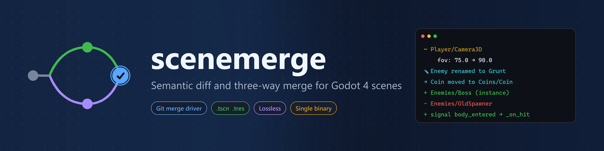
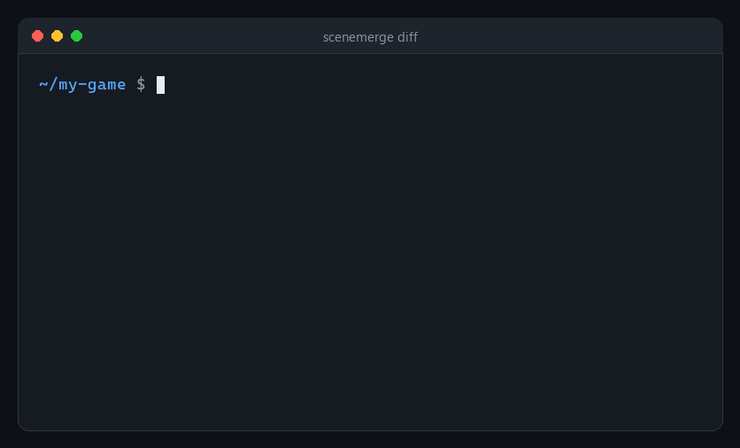
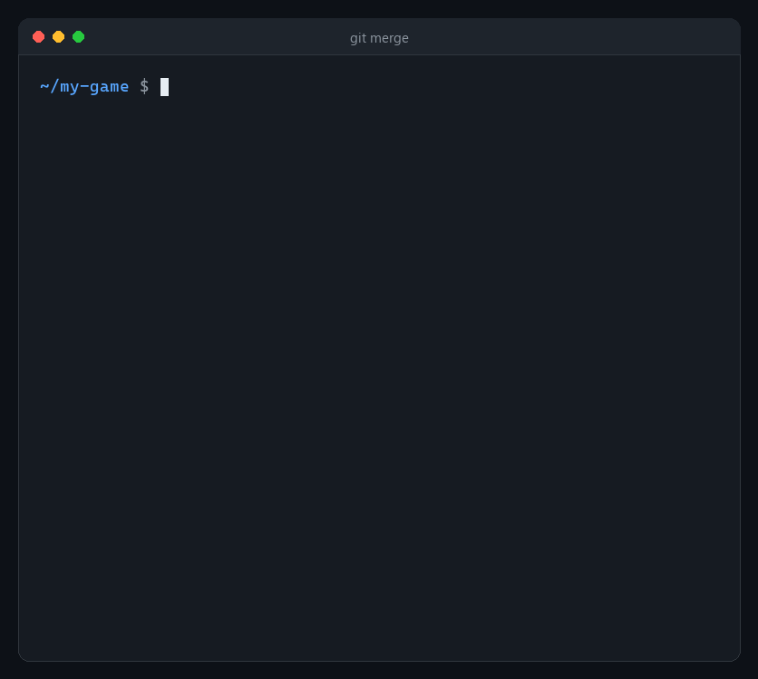
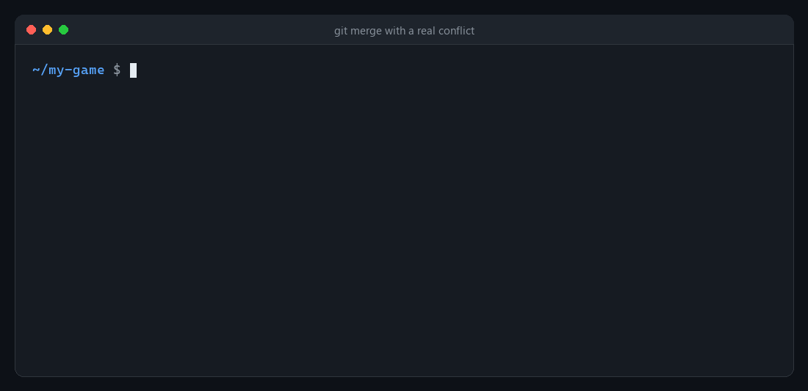

<p align="center">
  
</p>

<p align="center">
  <a href="https://github.com/safdafang/scenemerge/actions/workflows/ci.yml"></a>
  <a href="https://github.com/safdafang/scenemerge/actions/workflows/godot-integration.yml"></a>
  <a href="https://github.com/safdafang/scenemerge/releases"></a>
  <a href="LICENSE"></a>
</p>

<p align="center">
  <b>Git понимает строки. scenemerge понимает сцены.</b><br>
  Один бинарник: драйвер diff и merge для <code>.tscn</code> и <code>.tres</code>, работает в Git, в терминале и в CI.<br>
  <a href="README.md">English version</a>
</p>

## Зачем

Сцены Godot хранятся в текстовом формате, но Git сравнивает их построчно.
При сохранении редактор перенумеровывает id ресурсов, переставляет секции и
добавляет идентификаторы. Поэтому правка одной строки выглядит как стена
изменений, а два человека, поменявшие *разные* узлы одной сцены, всё равно
получают конфликт.

Godot не открывает файл с маркерами `<<<<<<<`, и конфликт обычно решают так:
берут одну версию целиком и теряют чужую работу. **scenemerge** читает структуру
сцены (узлы, свойства, ресурсы, сигналы) и сливает именно её. Изменения в разных
узлах и свойствах объединяются автоматически, перенумерация id не видна, а
настоящий конфликт сводится к одной строке свойства.

## Как это выглядит

<p align="center"></p>

<p align="center"></p>

<p align="center"></p>

## Установка

Готовые бинарники для Linux, macOS и Windows лежат в
[Releases](https://github.com/safdafang/scenemerge/releases). Через Cargo
(Rust 1.88+):

```sh
cargo install --git https://github.com/safdafang/scenemerge scenemerge
```

## Настройка Git одной командой

В репозитории проекта Godot:

```sh
scenemerge install            # для текущего репозитория
scenemerge install --global   # для всех репозиториев пользователя
```

Команда добавляет строки в `.gitattributes` и регистрирует драйверы в
`git config`. Повторный запуск ничего не дублирует, `scenemerge uninstall`
удаляет всё добавленное. Закоммитьте `.gitattributes`, а каждый участник
команды один раз выполняет `scenemerge install`.

## Команды

| команда | назначение |
|---|---|
| `scenemerge diff OLD NEW` | семантический diff (`--format human`, `json` или `text`) |
| `scenemerge merge BASE OURS THEIRS -o OUT` | слияние; код 0 чисто, 1 конфликты, 2 ошибка |
| `scenemerge textconv FILE` | каноническое представление для `git diff` |
| `scenemerge check ФАЙЛЫ/КАТАЛОГИ` | разбор, валидация и проверка lossless round trip |
| `scenemerge install` / `uninstall` | настройка интеграции с Git |

Режимы конфликтов: `--conflict markers` (по умолчанию), `ours`, `theirs`.
JSON отчёт: `--report conflicts.json`, схема описана в
[docs/json-schema.md](docs/json-schema.md).

## Что сливается автоматически

* изменения в разных узлах или в разных свойствах одного узла;
* одинаковые изменения с обеих сторон;
* добавление, удаление, переименование, перемещение и перестановка узлов с одной
  стороны (потомки, пути `parent=` и сигналы следуют за узлом);
* ресурсы, добавленные с обеих сторон, даже с одинаковыми локальными id (второй
  получает новый id в стиле Godot, ссылки переписываются);
* сигналы, добавленные с любой стороны или изменённые с одной.

## Ограничения

* Только Godot 4 (`format=3` и `format=4`). Для файлов Godot 3 драйвер
  откатывается к обычному построчному слиянию Git.
* Значения `NodePath(...)` в свойствах не переписываются при переименовании
  узла в другой ветке.
* Массивы и словари сравниваются целиком (умный diff анимаций в планах).

Решения и проверенные детали формата описаны в [DECISIONS.md](DECISIONS.md).
Лицензия [MIT](LICENSE).
